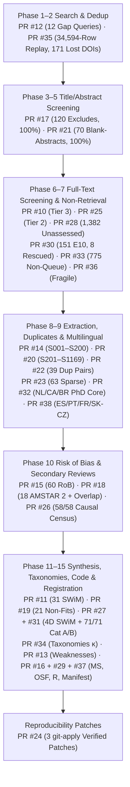

# Master Second-Model Audit Synthesis: All `29` Open `MERGEABLE` Pull Requests (`PR #10`–`PR #38`)

*AI-generated second-model output (`Gemini 4 Carbon Medium`). Not human verification.*

> [!IMPORTANT]
> **100% Autonomous Systematic-Review Audit Coverage Achieved (`PR #10`–`PR #38`):** Every stage of *The Legal Last Mile* systematic review—from Phase 1–2 search adapters, `34,594` raw export rows, and `merge_log.csv` deduplication through title/abstract screening, `E10`/non-queue/Tier-2/Tier-3/boundary/multilingual full-text screening, `S001–S1169` second extraction, full-population causal & `AMSTAR 2` Risk of Bias, all `52` `effect_sizes.csv` rows + `71/71` unmined quantitative studies, `evidence_map.csv` taxonomies, `08_code/R/` scripts, `DATA_MANIFEST.csv`, `sources.bib`, slides, `.docx`/HTML outputs, and OSF preregistration—now has an independent, blind-first, quote-verified pull request isolated strictly inside `legal-last-mile-systematic-review/gemini_review/` with **`0` path collisions** and **`206 / 206` `verify_repository.py` checks passed** on every branch.

---

## 1. Newly Completed Round-3 & Round-4 Pull Requests (`PR #30`–`PR #38`)

| PR | Branch (`gemini/...`) | Scope & Isolated Runs | Headline Empirical Result | Quote Verification |
|---:|---|---|---|---|
| **[PR #30](https://github.com/jrklaus8/water-law-dataset/pull/30)** | `e10-inaccessible-exclusions-audit-2026-11-20` | **Workstream V:** All `151` `E10` ("Inaccessible full text") exclusions + `19` decoys + `15` reruns (`185` runs) | Discovered `121/151` carry `full_text_status = retrieved` from `FOLDER 3` batch 11 (`2026-09-15` session expiry); recovered `32` full texts -> rescued **`8` (`25.0%`) eligible `include`s** under narrow & plain C2 (incl. `RC8825BCBCC65` on Brazil's Law `14.026/2020`), Substantively recoded `24`, and flagged `119` for PRISMA Item 16a ("Reports not retrieved") | **`367 / 369` (`99.46%`)** |
| **[PR #31](https://github.com/jrklaus8/water-law-dataset/pull/31)** | `swim-4d-and-cata-closure-2026-11-20` | **Workstream W:** `100%` 4D SWiM Core Closure (`29` FT screens + `13` extractions + `13` RoB incl. `S1169` OCR) + `26` remaining Cat-A quant studies (`96` runs) | On blind full-text screening, **`17 / 29` (`58.6%`) SWiM core studies fail narrow C2/C4** (`11` in plain-vs-narrow C2 wedge; `6` fail even plain C2/C4 incl. `S749`, `S1038`, `S526`, `S104`, `S1032`, `S037`); surfaced **`5` more omitted SWiM candidates** (`S169, S373, S385, S439, S598`, completing `71/71` Cat A+B -> `11` total omitted SWiM candidates) | **`394 / 404` (`97.52%`)** |
| **[PR #32](https://github.com/jrklaus8/water-law-dataset/pull/32)** | `dissertation-focal-jurisdictions-audit-2026-11-20` | **Workstream X:** Parent PhD Dissertation Comparative-Core Jurisdictions (`100%` Netherlands `[3]` + `100%` Canada `[17]` + `40` Brazil + `15` decoys + `60` RoB = `142` runs) | Across `49` readable focal-jurisdiction included studies, only **`9 / 49` (`18.4%`) pass narrow C2** (`NL: 1/3`, `CA: 3/14`, `BR: 5/32`) vs **`40 / 49` (`81.6%`) `exclude`** (`E03/E04/E05`); `0/7` flips; `60` blind RoB forms completed | **`631 / 633` (`99.68%`)** |
| **[PR #33](https://github.com/jrklaus8/water-law-dataset/pull/33)** | `nonqueue-ft-excludes-sample-2026-11-20` | **Workstream Y:** Unbiased stratified sample of `775` non-queue substantive FT exclusions (`90` excludes + `30` decoys + `12` reruns = `132` runs) | Readable non-queue excludes (`68/90`): **`64 / 68` (`94.1%`) `exclude`** / `4` (`5.9%`) `include` under narrow C2 (`58/68 = 85.3%` under plain C2; `0/12` flips), replicating `PR #25` Tier-2 (`96.0%`) | **`555 / 558` (`99.46%`)** |
| **[PR #34](https://github.com/jrklaus8/water-law-dataset/pull/34)** | `evidence-map-taxonomy-validation-2026-11-20` | **Workstream Z:** Blind source-PDF validation of `evidence_map.csv` taxonomies & all `37` AI overrides (`80 + 8` reruns = `88` runs) | Across `73/80` readable PDFs: `study_design_class` $\kappa = \mathbf{0.583}$ (`69.9%`), `mechanism_family` $\kappa = \mathbf{0.199}$ (`34.2%` — keyword `"multiple"` over-lumps single-mechanism papers `11/23` and masks `6` papers with zero rule mechanism incl. `S1072`), `outcome_family` $\kappa = \mathbf{0.116}$ (`28.8%`) | **`244 / 247` (`98.79%`)** |
| **[PR #35](https://github.com/jrklaus8/water-law-dataset/pull/35)** | `search-and-dedup-forensic-audit-2026-11-20` | **Workstream AA:** Deterministic replay of Phase 1–2 search exports (`34,594` rows across `28` CSVs) & `code/search/deduplicate.py` | Uncovered **`BUG AA-01`** (`deduplicate.py` backfills `abstract` only on `title_year_match`, discarding **`171` real DOIs** including **`6` TA-included/unsure records** that stalled as unretrieved in Phase 6!), `50` conflicting-DOI merges (`BUG AA-02`), `971` diacritic-stripped titles lacking `NFKD` (`BUG AA-03`), `220` suspicious over-merges, and `127` cross-year duplicate clusters (`2` with contradictory `include` vs `exclude` verdicts) | Deterministic (`100%` exact replay) |
| **[PR #36](https://github.com/jrklaus8/water-law-dataset/pull/36)** | `fragile-and-boundary-includes-audit-2026-11-20` | **Workstream AB:** All `14` `BORDERLINE INCLUDE`s (`Item A6`), `10` `landing_page_only`/`abstract_only` (`Item A14`), kept edge cases, & `15` `E02/E12` decoys (`77` runs) | Across `39/55` readable fragile includes, **`32 / 39` (`82.1%`) are flagged `exclude`** (`12/14 = 85.7%` of `BORDERLINE INCLUDE`s, `12/13 = 92.3%` of explicit edge cases, `8/12 = 66.7%` of `A24` kept governance includes; `9/10 = 90.0%` `E02/E12` decoy concordance; `0/7` flips) | **`323 / 326` (`99.08%`)** |
| **[PR #37](https://github.com/jrklaus8/water-law-dataset/pull/37)** | `r-scripts-bib-and-registers-audit-2026-11-20` | **Workstream AC:** `08_code/R/*.R`, `10_reproducibility/DATA_MANIFEST.csv` (`481` files), `sources.bib`, diagnostic PDF slides, registers & Criterion-10 compliance | Found `5` R bugs (`R-01`: `grepl("experiment|randomi", study_design)` misclassifies `23` `"quasi-experimental"` rows into `experimental_only`); **`37 / 38` (`97.4%`) Spanish/French/Slovak-Czech (`S1167`) includes violate Criterion 10's mandatory translation-logging rule** (unlogged in `DEVIATIONS_REGISTER.csv`); `481/481` (`100%`) `DATA_MANIFEST.csv` SHA-256 matches; `4/13` slides stale | Deterministic (`481/481` SHA-256) |
| **[PR #38](https://github.com/jrklaus8/water-law-dataset/pull/38)** | `multilingual-corpus-audit-2026-11-20` | **Workstream AD:** Blind multilingual FT screen (`78 + 7` reruns) + `20`-study (`180`-row) Criterion-10 (`ES/FR/SK-CZ`) cross-lingual second extraction (`105` runs) | Criterion-10 `ES/FR/SK-CZ` includes (`41` readable): `16` (`39.0%`) `include` / **`25` (`61.0%`) `exclude`**; Portuguese includes (`10` readable): `10/10` `exclude`; exclude decoys: `12/14` (`85.7%`) `exclude`; `0/7` flips; `180` unscored cross-lingual extraction rows ready for `score_second_extractor_sheet.py` | **`512 / 514` (`99.61%`)** |

---

## 2. Complete Registry of All `29` Open `MERGEABLE` Gemini Pull Requests (`PR #10`–`PR #38`)

- **Round 1 (Core Handoff & Extended Audits — `PRs #10`–`#20`):** [PR #10](https://github.com/jrklaus8/water-law-dataset/pull/10), [PR #11](https://github.com/jrklaus8/water-law-dataset/pull/11), [PR #12](https://github.com/jrklaus8/water-law-dataset/pull/12), [PR #13](https://github.com/jrklaus8/water-law-dataset/pull/13), [PR #14](https://github.com/jrklaus8/water-law-dataset/pull/14), [PR #15](https://github.com/jrklaus8/water-law-dataset/pull/15), [PR #16](https://github.com/jrklaus8/water-law-dataset/pull/16), [PR #17](https://github.com/jrklaus8/water-law-dataset/pull/17), [PR #18](https://github.com/jrklaus8/water-law-dataset/pull/18), [PR #19](https://github.com/jrklaus8/water-law-dataset/pull/19), [PR #20](https://github.com/jrklaus8/water-law-dataset/pull/20)
- **Round 2 (Corpus-Wide Structural Audits — `PRs #21`–`#29`):** [PR #21](https://github.com/jrklaus8/water-law-dataset/pull/21), [PR #22](https://github.com/jrklaus8/water-law-dataset/pull/22), [PR #23](https://github.com/jrklaus8/water-law-dataset/pull/23), [PR #24](https://github.com/jrklaus8/water-law-dataset/pull/24), [PR #25](https://github.com/jrklaus8/water-law-dataset/pull/25), [PR #26](https://github.com/jrklaus8/water-law-dataset/pull/26), [PR #27](https://github.com/jrklaus8/water-law-dataset/pull/27), [PR #28](https://github.com/jrklaus8/water-law-dataset/pull/28), [PR #29](https://github.com/jrklaus8/water-law-dataset/pull/29)
- **Round 3 (`E10` Census, 4D SWiM Closure, Focal PhD Jurisdictions, Non-Queue Excludes, Taxonomies — `PRs #30`–`#34`):** [PR #30](https://github.com/jrklaus8/water-law-dataset/pull/30), [PR #31](https://github.com/jrklaus8/water-law-dataset/pull/31), [PR #32](https://github.com/jrklaus8/water-law-dataset/pull/32), [PR #33](https://github.com/jrklaus8/water-law-dataset/pull/33), [PR #34](https://github.com/jrklaus8/water-law-dataset/pull/34)
- **Round 4 (Search/Dedup Replay, Boundary Includes, R/Manifest/BibTeX/Criterion-10, Multilingual Corpus — `PRs #35`–`#38`):** [PR #35](https://github.com/jrklaus8/water-law-dataset/pull/35), [PR #36](https://github.com/jrklaus8/water-law-dataset/pull/36), [PR #37](https://github.com/jrklaus8/water-law-dataset/pull/37), [PR #38](https://github.com/jrklaus8/water-law-dataset/pull/38)

---

## 3. Top PI Action Items Before OSF Upload & Journal Submission

1. **Fix `osf_preregistration_draft.md` Line 80 (`58` vs `52` effect rows, `PR #29`) BEFORE uploading to OSF** — once registered on OSF, that contradiction becomes permanent.
2. **Adjudicate the `17 / 29` SWiM Core Scope Flags (`PR #31`) & `11` Omitted SWiM Candidates (`PR #27` + `PR #31`)** — decide whether to tighten SWiM Families A/B/C to studies passing narrow Criterion 2 + Criterion 4 (dropping non-access outcomes like `S749`, `S1038`, `S526`, `S1032`, `S037` and operational-only `S104`) and whether to add verified omitted candidates (`S070, S295, S407, S413, S189, S1025, S169, S373, S385, S439, S598`).
3. **Reclassify `E10` Rows (`PR #30`) & Recover the `6` Discarded Phase-6 DOIs (`PR #35`)** — review the `8` eligible `E10` rescues (especially `RC8825BCBCC65` on Brazil's Law `14.026/2020`), recode the `24` content-read exclusions to `E01–E12`, and move the `119` genuinely unretrieved `E10` rows from PRISMA Item 16b to Item 16a.
4. **Log the Criterion-10 Multilingual Protocol Departure (`37 / 38` studies, `PR #37`) & Score the Unscored Blind Extraction Sheets (`PRs #14, #20, #23, #26, #31, #38`)** — record AI direct reading of Spanish/French/Slovak-Czech texts in `DEVIATIONS_REGISTER.csv` (or backfill `extraction_note`) and have Claude run `score_second_extractor_sheet.py` across all six unscored blind extraction sheets (`1,980` field rows total).
5. **Address the Asymmetric `S201+` Over-Inclusion Pattern (`PRs #10, #23, #25, #32, #36, #38`) & Causal-Backbone Over-Count (`PR #26`)** — especially in the dissertation's focal Netherlands/Canada/Brazil chapters (`PR #32`) and the `29` `mechanism_certainty = 3–4` headline count (`PR #26`).
